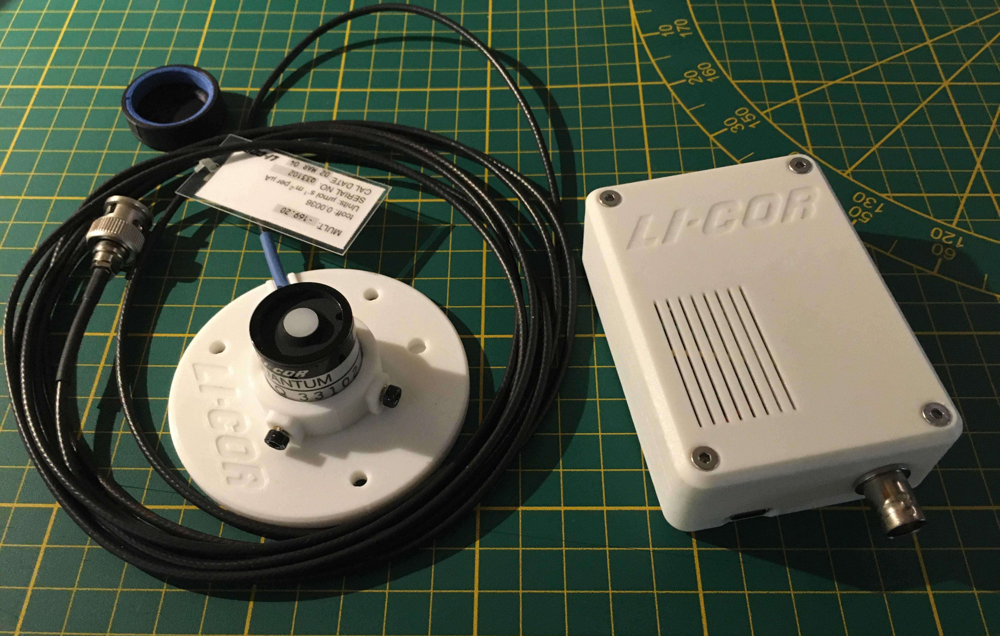
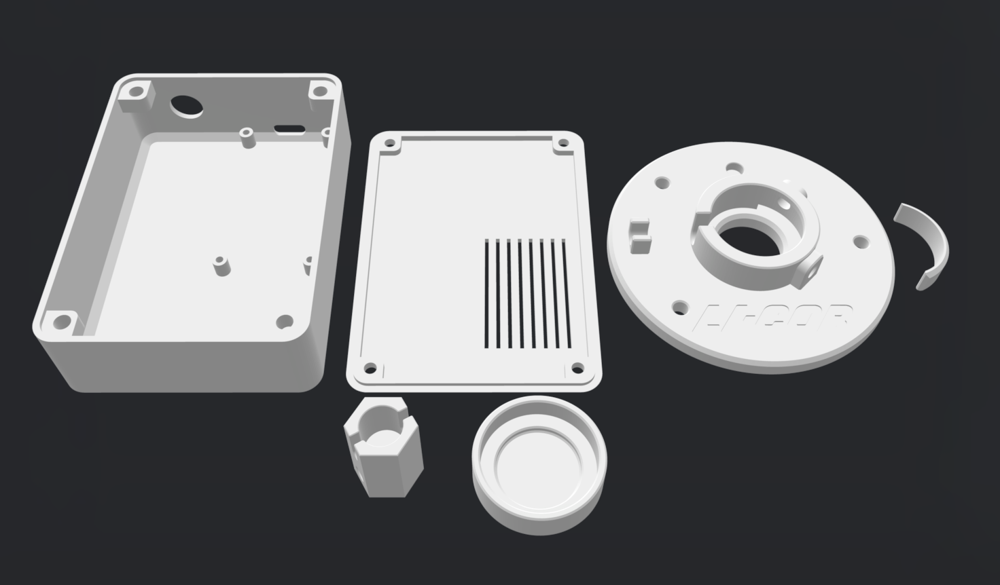
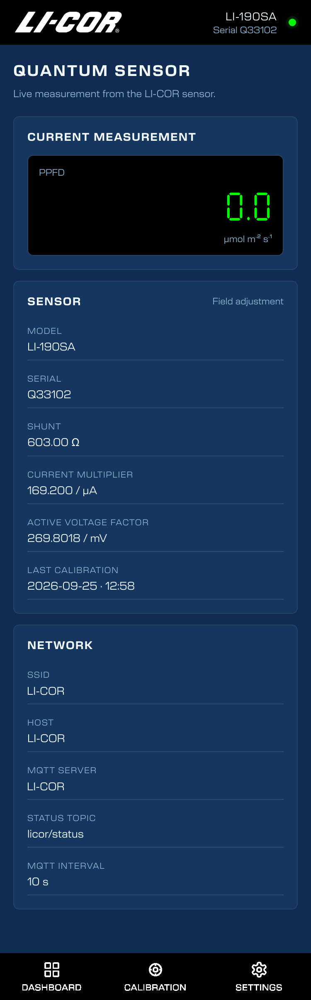
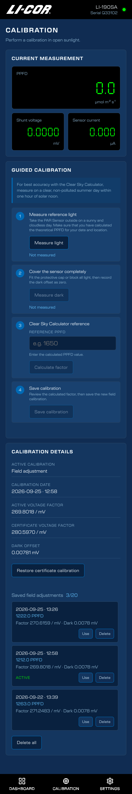
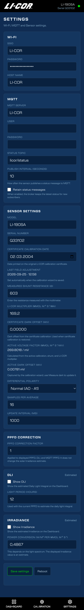
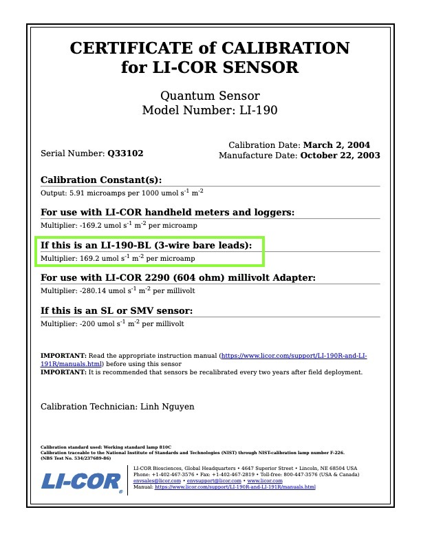

<h1 align="center">
	LI-190 PAR Meter
</h1>


<p align="center">
<i> This is an independent, unofficial project and is not affiliated with,
endorsed, or sponsored by LI-COR, Inc.</i>
</p>

<br>

<br>

## Introduction
This project reads the self-powered microampere output of a LI-COR LI-190 quantum sensor with an ESP32 and an ADS1115 ADC.

While researching how to check and adjust an older PAR sensor, I came across [Vernier’s](https://www.vernier.com/til/3108) technical note about using the [Clear Sky Calculator](https://www.clearskycalculator.com/) for a calibration.


I found their guided procedure interesting: measure the sensor in clear sunlight using the calculated PPFD as a reference, then perform a dark/zero measurement and store the resulting calibration. I thought this was a practical concept and decided to integrate a similar guided field-adjustment workflow into the firmware.

This firmware provides:

- Differential ADS1115 measurement
- Configurable shunt resistance and LI-COR current multiplier
- Automatic sensor sampling with averaging
- Optional PPFD correction factor
- Optional estimated PAR irradiance in W/m²
- Optional DLI calculation for a configurable light period
- Wi-Fi configuration and device-hosted web interface
- Automatic setup access point if Wi-Fi is unavailable
- MQTT status publishing
- Certificate calibration data and reversible field adjustment
- LittleFS-persisted configuration


The STL file for the case, fixture, cap, and a BNC wrench is available in the `cad/stl/` folder.

<details>
<summary>
 STL
</summary> <br />


Required hardware:

- 6 × M3 × 5 × 4 threaded heat-set inserts
- 2 × M3 × 6-8 socket-head screws
- 4 × M3 × 8-10 countersunk socket-head screws
- A narrow strip of foam rubber for the cap
</details>


<details open>
<summary>
 Screenshots
</summary> <br />






</details>

## 1. Sensor and shunt

The LI-190SA is a self-powered sensor. Its output is a current signal. Do not
connect an external voltage source to the sensor and do not power the sensor
from the ESP32.

The shunt resistor converts the sensor current into a voltage suitable for the
ADS1115. LI-COR documentation commonly specifies a 604 Ω voltage-input
configuration. For this build, I used two 47 Ω resistors and one 510 Ω
resistor in series, all rated at 1%. The assembled shunt measured 603 Ω.
The measured value, rather than the nominal resistor sum, is entered in the
configuration.

Important:

- Measure the complete effective shunt resistance with a multimeter.
- Use the multiplier from this sensor's calibration certificate. It is
  specified in µmol m⁻² s⁻¹ per microamp.

<details>
<summary>
 Certificate
</summary> <br />

</details>


## 2. Hardware and wiring

### 2.1 Signal path

For the BNC version, LI-COR specifies the connector body/shield as the
positive signal and the center contact as the negative signal.


```text
               R_SHUNT (measured)
Sensor lead A o----/\/\/----o Sensor lead B
              |             |
            ADS A0        ADS A1
```
The shunt is connected across the two sensor output leads. The ADS1115 reads
the voltage differentially.


### 2.2 ESP32 / ADS1115 connections

```text
ADS1115 VDD  -> ESP32 3.3 V
ADS1115 GND  -> ESP32 GND
ADS1115 SDA  -> ESP32 GPIO 21
ADS1115 SCL  -> ESP32 GPIO 22
ADS1115 A0   -> BNC body/shield (+) side of the shunt
ADS1115 A1   -> BNC center-contact (−) side of the shunt
```

The current implementation uses ADS1115 differential channel `0-1` and gain
`GAIN_SIXTEEN` (±0.256 V full-scale). The expected signal is only a few
millivolts in normal full sunlight, so this gain provides useful resolution
and substantial headroom.

The firmware initializes the bus on GPIO 21/22 at 100 kHz and automatically
detects the ADS1115 address. If no address responds, the sensor readings stay
at zero and the web interface remains available so the wiring can be checked.

If the measured voltage is negative under light, use
`Reversed (A1 - A0)` in the web settings.

## 3. Wi-Fi startup behavior

At startup, the ESP32 tries the configured Wi-Fi network for 10 seconds. If
the SSID is empty or the connection fails, it starts an open setup access
point named `<HostName>-AP-Mode` (for example, `LI-COR-AP-Mode`). Connect
to that network and open `http://192.168.4.1/` to configure Wi-Fi and MQTT.
The device must be rebooted after saving new Wi-Fi settings so it can try the
configured network again.

## 4. Configuration file

The complete configuration can be performed through the web interface.
For the initial setup, you may also edit `data/config.json` before uploading
the LittleFS filesystem.

The configuration can later be viewed at http://esp-ip/config.json.

Example structure:

```json
{
  "SSID": "--",
  "PASS": "--",
  "MQTTSERVER": "--",
  "MQTTUser": "",
  "MQTTPass": "",
  "TopicSTATUS": "licor/status",
  "MQTTIntervalSeconds": 10,
  "MQTTRetainStatus": false,
  "ShowIrradiance": false,
  "ShowDLI": false,
  "DLILightHours": 12,
  "PpfdCorrectionFactor": 1.0,
  "HostName": "LI-COR",
  "Sensor": {
    "Model": "LI-190SA",
    "Serial": "Q33102",
    "ActiveCalibration": "certificate",
    "ShuntResistanceOhms": 603.0,
    "MultiplierUmolPerUa": 169.2,
    "VoltageMultiplierUmolPerMv": 280.5970,
    "DifferentialPolarity": 1,
    "DarkOffsetMv": 0.0,
    "SampleCount": 16,
    "SampleIntervalMs": 1000,
    "WPerM2PerUmol": 0.4867
  },
  "FactoryCalibration": {
    "MultiplierUmolPerUa": 169.2,
    "DarkOffsetMv": 0.0,
    "CalibrationDate": "2004-03-02"
  },
  "FieldAdjustments": [],
  "LastFieldAdjustment": {
    "Available": false,
    "Id": "",
    "ReferencePpfd": 0.0,
    "VoltageMultiplierUmolPerMv": 0.0,
    "DarkOffsetMv": 0.0,
    "Date": "",
    "ShuntResistanceOhms": 603.0,
    "MultiplierUmolPerUa": 169.2
  }
}
```
## 5. Calibration

The project distinguishes between two calibration states.

### Certificate calibration

Certificate calibration is the normal baseline. It uses:

- The LI-COR current multiplier from the certificate
- The actually measured shunt resistance
- The certificate dark offset stored in `FactoryCalibration.DarkOffsetMv`

Changing the shunt or LI-COR multiplier in Settings automatically switches the
active calculation back to certificate mode and recalculates the active
voltage factor from the values in `config.json`. The previous field adjustment
is retained as a backup.

The certificate date is entered separately in Settings. It is metadata from the
original certificate; editing the date does not perform a new calibration.

### Field adjustment

- A field adjustment is not a replacement for factory recalibration.

For this project, field adjustment primarily uses the Clear Sky Calculator as
a model-based PPFD reference. For best accuracy, measure on a clear,
non-polluted summer day within one hour of solar noon. A calibrated reference
meter can also be used. The adjustment changes the active factor and dark
offset for this reader, but it does not alter the original certificate data.

Each field-adjustment result is saved in `FieldAdjustments`, including:

- A unique `Id`
- Calculated voltage factor
- Measured dark offset
- Reference PPFD used for the adjustment
- Date saved by the wizard
- An `Active` flag

The `LastFieldAdjustment` object is kept as a compact summary of the most
recently saved adjustment. The field-adjustment list is stored in LittleFS and
is limited to 20 entries; when the limit is reached, the oldest entry is
removed before the new one is saved.

### 5.1 PPFD correction, DLI and Irradiance

`PpfdCorrectionFactor` is an optional spectral correction factor intended
primarily for LED-based light sources. Set it only when a suitable correction
value is known; otherwise, leave it at `1.0`.

The firmware first calculates the calibrated sensor value and then applies
`PpfdCorrectionFactor`:

```text
raw_PPFD = max(0, (voltage_mV - dark_offset_mV) × active_factor)
PPFD     = raw_PPFD × PpfdCorrectionFactor
```

The correction factor affects the displayed PPFD, the Dashboard DLI estimate,
and the PPFD value published to MQTT. It does not alter the certificate or
field-calibration factors.

DLI is calculated from the corrected PPFD and the configured
`DLILightHours` value. When `ShowDLI` is
enabled, the Dashboard calculates:

```text
DLI = PPFD × light-period hours × 3600 / 1,000,000
```

Irradiance is a solar estimate. When `ShowIrradiance` is
enabled, the Dashboard calculates:

```text
estimated_W_per_m² = raw_PPFD × WPerM2PerUmol
```

The PPFD correction factor is deliberately not applied to Irradiance.

## 6. Calibration wizard


### Step 1: Reference light

1. Place the sensor in the sun.
2. Remove any cover from the sensor head.
3. Keep the sensor orientation stable.
4. Press **Measure light**.
5. The wizard requests a fresh sensor reading and stores its voltage.

For best accuracy with the [Clear Sky Calculator](https://www.clearskycalculator.com/), measure on a clear,
non-polluted summer day within one hour of solar noon.


### Step 2: Dark measurement

1. Cover the sensor head completely.
2. Wait for the voltage to stabilize.
3. Press **Measure dark**.
4. The wizard requests a fresh sensor reading and stores the dark offset.

The field dark offset is captured by the wizard and shown in Sensor settings
as **Active dark offset (mV)**. The certificate dark offset is separately
editable in Sensor settings and is used when certificate calibration is active
or restored.

### Step 3: Calculate

Enter the calculated PPFD under **Clear Sky Calculator reference**.


The wizard calculates:

```text
effective_voltage_mV = reference_voltage_mV - dark_offset_mV
field_factor         = reference_PPFD / effective_voltage_mV
```

The calculation is rejected if the effective voltage or reference PPFD is not
positive. The reference input itself remains available while the wizard waits
for the measurement steps.

### Step 4: Save

Saving the wizard result:

- Sets `Sensor.ActiveCalibration` to `field`
- Stores the calculated factor in the sensor configuration
- Stores the dark offset
- Adds a new entry to `FieldAdjustments` and marks it active
- Updates `LastFieldAdjustment` with the saved adjustment and the configured
  shunt as calibration metadata
- Adds the current date to the field adjustment

The Dashboard then shows `Field adjustment` and its wizard date as the active
calibration.

### Restoring the certificate calibration

**Restore certificate calibration**:

- Sets `ActiveCalibration` to `certificate`
- Restores the certificate current multiplier
- Recalculates the voltage factor for the currently configured shunt
- Restores `FactoryCalibration.DarkOffsetMv`
- Keeps saved field adjustments available in the list

### Using and deleting saved field adjustments

Each saved entry can be activated with **Use**. This applies its factor and
dark offset, marks it active, and sets `Sensor.ActiveCalibration` to `field`.

**Delete** removes one entry. If the deleted entry was active, the newest
remaining entry becomes active. If it was the last entry, the firmware
automatically restores the certificate calibration. **Delete all** removes all
saved entries and restores the certificate calibration.

## 7. MQTT

The firmware publishes a minimal status payload to `TopicSTATUS`, normally
`licor/status`:

```json
{
  "device": "LI-COR",
  "Ppfd": 1198.78
}
```
The MQTT publish interval and whether status messages are retained can be
configured through the web interface.

## 8. Software dependencies

The Arduino project requires libraries providing:

- `Adafruit ADS1X15`
- `PubSubClient`
- `ArduinoJson`
- `AsyncTCP`
- `ESPAsyncWebServer`

The selected ESP32 board package must be installed in the Arduino toolchain.
The exact board variant and upload port should be confirmed before the first
compile or flash.

## 9. LittleFS and deployment

The `data` directory is the source for the device filesystem. It must be
uploaded to LittleFS together with the firmware so that the ESP32 has:

- `index.html`
- `manifest.json`
- `config.json`
- `licor-logo.png`
- `favicon.png`
- `fonts/New_Science_Regular.otf`
- `fonts/New_Science_Bold.otf`
- `fonts/Seven_Segment.ttf`

Initial setup:

1. Optionally edit `data/config.json` with initial values before uploading
   LittleFS.
2. Upload the firmware and the `data` directory to the ESP32.
3. Open the web interface and verify the sensor, shunt, certificate, Wi-Fi,
   MQTT, polarity, sampling, and power-conversion settings.
4. Optionally perform a Clear Sky Calculator field adjustment under the
   recommended clear-sky conditions.

## License

This project is licensed under the **PolyForm Noncommercial License 1.0.0**. Use for personal, educational, and non-commercial purposes is permitted free of charge. Any commercial use is strictly prohibited without prior written permission.
